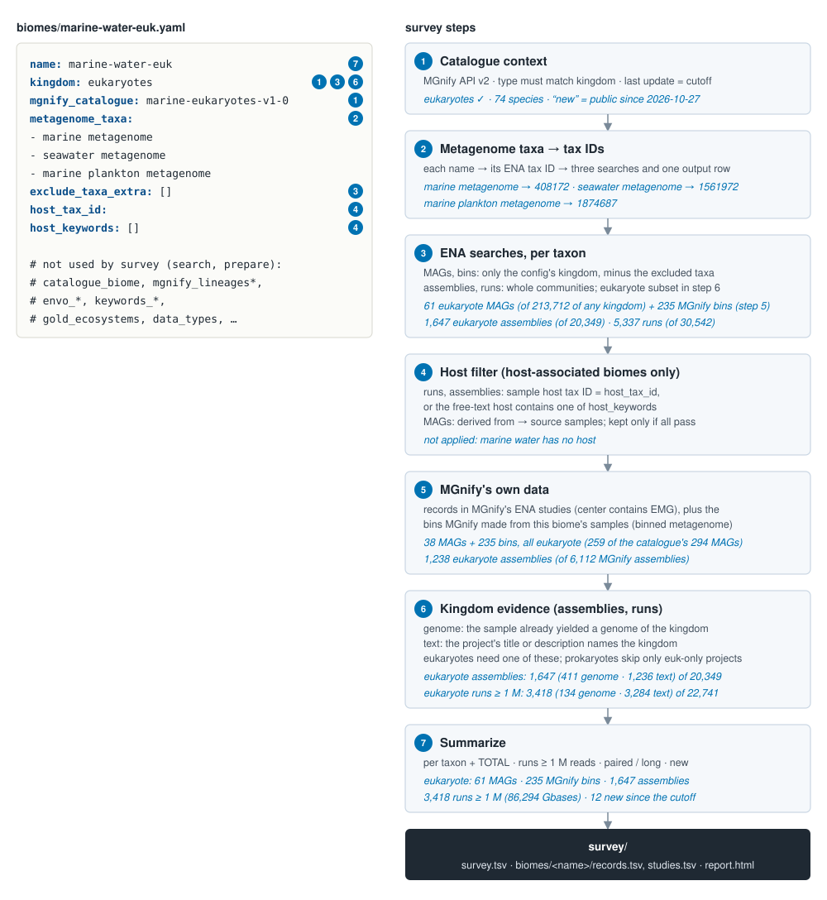

# survey

`survey` counts the public data available in ENA for one or more candidate biomes, before
any curation: MAGs, metagenome assemblies, read runs and the genomes MGnify produced. ENA is
part of INSDC, so runs and WGS genomes submitted to NCBI or DDBJ are expected included (see [Limitations](#limitations)).

MGnify is used for context (existing catalogues and their genomes, and samples per biome lineage).
Use the survey to decide which biomes are worth building a catalogue for, and whether an existing
MGnify catalogue has enough new data to justify an update.

## Usage

```bash
biome-finder survey --biomes biomes/*.yaml --out survey/
```

| Option | Description |
|---|---|
| `--biomes` | Biome YAML configs. Several files can follow one `--biomes` (shell globs work), or the option can be repeated. |
| `--out` | Output folder (default `survey/`). |

## How it works

The biome config drives every query. The figure follows one config,
[`biomes/marine-water-euk.yaml`](#worked-example-marine-water-euk): each field carries the
number of the step it feeds, and each step shows the example's result (the figure is drawn
by `docs/img/survey_flow.py`). The table after it lists what every field does.



### What each config field does

| Field | Step | Effect on the survey |
|---|---|---|
| `name` | output | the `biome` column, the `biomes/<name>/` folder and the dashboard's catalogue list |
| `kingdom` | MAG search, kingdom evidence | **required.** `prokaryotes` searches MAGs under Bacteria (2) and Archaea (2157), `eukaryotes` under Eukaryota (2759), one query each, so every MAG is tagged with its group (`scope_taxon`). Must match the catalogue's type. It also decides which assemblies and runs count as evidence for the kingdom (below) |
| `exclude_taxa_extra` | MAG search | tax trees removed from the MAG search, on top of Viruses, Metazoa, Tracheophyta and Phaeophyceae |
| `mgnify_catalogue` | catalogue context | read from the MGnify API v2: species and genome counts, and the last-update date that becomes the cutoff for every `*_new` column. Its `catalogue_type` must equal `kingdom`, or the survey stops. Empty = new catalogue, no `*_new` columns |
| `metagenome_taxa` | ENA searches | the core of the survey: each name is resolved to a tax ID and gets its own three searches and its own output row. MAGs match it through `metagenome_source`; assemblies and runs through the sample's taxon (`tax_eq`, exact, no child taxa) |
| `host_tax_id`, `host_keywords` | ENA searches | assemblies and runs must match the host tax ID *or* a keyword in the free-text `host` field. MAGs are traced through `derived from` to their source samples, and kept only if every source matches |
| `catalogue_biome`, `mgnify_lineages`, `mgnify_lineages_exclude`, `envo_include`, `envo_exclude`, `gold_ecosystems`, `keywords_include`, `keywords_exclude`, `host`, `data_types`, `lineage_equivalents`, `ncbi_isolate_query`, `ncbi_wgs_terms`, `min_study_yield`, `indicpiper_habitats`, `contaminant_reference`, `notes` | — | not used by `survey`. They drive `search` (biome evidence and scoring) and `prepare` (pipeline inputs) |

Six rules apply on top of the config:

- **Read runs** are all counted in `runs`; the other read columns keep only runs with at
  least 1 million reads, split into paired short reads and long reads (Oxford Nanopore,
  PacBio).
- **MGnify's own data**: a record deposited in one of MGnify's ENA studies (a study whose
  center name contains `EMG`, e.g. `EMG` or `EMG;EMBL-EBI`) is flagged `from_mgnify`, which
  feeds `mags_mgnify` and `assemblies_mgnify`. MGnify also deposits the genomes it bins from
  public data as `binned metagenome` analyses, never as MAGs, so the survey searches those
  studies for bins of the config's kingdom. A bin counts (`mgnify_bins`) if every source
  sample (`derived from`) is a sample of the biome's assemblies or runs; it takes that
  sample's metagenome taxon. Bins from other submitters are not counted.
- **Kingdom evidence**: assemblies and runs are whole communities with no organism, so
  each one gets its sample's `kingdom_evidence`, strongest first: `genome` (the sample already
  yielded a MAG or MGnify bin of the config's kingdom), `study_text` (the title or description
  of one of the sample's projects names the kingdom, e.g. *protist*, *diatom*, *18S* for
  eukaryotes; *bacteria*, *archaea*, *16S* for prokaryotes), `none`, or `other_kingdom`
  (its projects name only the other kingdom). The sample is the unit: all its assemblies and
  runs, in whatever project, share one verdict, and `kingdom_terms` lists the terms found. A
  eukaryote config counts only `genome` and
  `study_text` (`assemblies_kingdom`, `runs_1m_kingdom`); a prokaryote config counts everything
  but `other_kingdom`, since prokaryotes are in nearly every metagenome. This is a coarse
  filter; the eukaryotic share of each run is for `search` to measure.
- **Already in the catalogue**: for an update, the survey reads the catalogue's genome list
  (`genomes-all_metadata.tsv` on the MGnify FTP) and flags every MAG and MGnify bin already
  in it (same accession, or same genome sample). The rest are `mags_to_add` and
  `mgnify_bins_to_add`; for a new catalogue, all of them are.
- **Where new genomes would come from**: each sample enters at its most processed public
  data. Assemblies (with kingdom evidence) whose sample has no genome yet are `assemblies_to_bin`
  (input for genomes-generation); runs ≥ 1 M reads (with kingdom evidence) whose sample has
  neither a genome nor an assembly are `runs_to_assemble` (input for miassembler, then
  genomes-generation). Genome samples come from each MAG's and bin's `derived from`.
- **TOTAL row**: the records of all taxa are pooled and counted again, so a study spanning
  several taxa is counted once. Each record has one taxon, so nothing is counted twice.

### Worked example: marine-water-euk

```yaml
name: marine-water-euk
kingdom: eukaryotes
mgnify_catalogue: "marine-eukaryotes-v1-0"
metagenome_taxa: ["marine metagenome", "seawater metagenome", "marine plankton metagenome"]
host: none
```

1. **Catalogue.** `marine-eukaryotes-v1-0` is a eukaryote catalogue, which matches
   `kingdom`. It has 74 species from 385 genomes, last updated 2026-10-27, so anything
   public from that date on counts as new.
2. **Taxa.** `marine metagenome` resolves to 408172, `seawater metagenome` to 1561972 and
   `marine plankton metagenome` to 1874687, so the survey runs 3 × 3 searches and writes
   three rows plus TOTAL.
3. **Kingdom.** ENA holds 213,712 MAGs from `marine metagenome` samples; restricting them
   to Eukaryota leaves **61**, all from that taxon and from 11 studies. None is newer than
   the cutoff. Assemblies and runs have no organism, so `kingdom` doesn't apply to them:
   these counts are what a eukaryote *and* a prokaryote marine-water config would both see,
   before step 6.
4. **Host.** No `host_tax_id` or `host_keywords`, so nothing is filtered by host. In a
   host-associated biome, assemblies and runs would have to match the host tax ID or a host
   keyword, and MAGs would be traced through `derived from` to their source samples.
5. **MGnify's own data.** 38 of the MAGs sit in MGnify's own studies, and MGnify binned
   another **235** eukaryote genomes from this biome's samples. Together they cover 259 of
   the 294 MAGs in the current catalogue (the rest come from samples outside the three
   taxa). 6,112 of the assemblies were made by MGnify, 1,356 of them with eukaryote evidence
   (step 6).
6. **Kingdom evidence.** Of the 20,349 assemblies, 4,616 have eukaryote evidence (411
   because their sample already yielded a eukaryote genome, 4,205 from project text);
   of the 22,741 runs with ≥ 1 M reads, 3,427 do (134 and 3,293). The other ~19 thousand
   runs are counted by `marine-water-prok`, not here.

| metagenome taxon | MAGs (euk) | MGnify bins (euk) | assemblies | with euk evidence | runs ≥ 1 M | with euk evidence | new | Gbases | read studies |
|---|---|---|---|---|---|---|---|---|---|
| marine metagenome | 61 | 235 | 18,107 | 4,592 | 17,562 | 3,199 | 12 | 250,985 | 2,019 |
| seawater metagenome | 0 | 0 | 1,484 | 14 | 4,571 | 216 | 9 | 68,133 | 1,188 |
| marine plankton metagenome | 0 | 0 | 758 | 10 | 608 | 12 | 0 | 5,347 | 21 |
| **TOTAL** | **61** | **235** | **20,349** | **4,616** | **22,741** | **3,427** | **21** | **324,466** | **3,220** |

So a eukaryote marine-water catalogue update would start from 61 MAGs and 235 MGnify bins
(none new), 4,616 assemblies and 3,427 runs with eukaryote evidence to bin or assemble, and
12 eukaryote runs public since the last update (`runs_1m_kingdom_new`; 21 counting any
kingdom). That small influx of new data is the kind of answer the survey is for.

## What the survey queries, step by step

This section lists every service the survey calls, in order, with the request it sends for
`biomes/marine-water-euk.yaml`. `{field}` marks a value taken from the YAML. Every response
is cached (see [Data access and caching](#data-access-and-caching)), so a second run makes
no requests.

| Service | Base URL |
|---|---|
| MGnify API v2 | `https://www.ebi.ac.uk/metagenomics/api/v2` |
| MGnify FTP | `https://ftp.ebi.ac.uk/pub/databases/metagenomics/mgnify_genomes` |
| ENA taxonomy | `https://www.ebi.ac.uk/ena/taxonomy/rest` |
| ENA Portal API | `https://www.ebi.ac.uk/ena/portal/api` |
| ENA Browser API | `https://www.ebi.ac.uk/ena/browser/api` |

ENA Portal searches always run in two calls: `GET /count?result=…&query=…` for the total,
then `POST /search` with `limit=0` for every row (large GET responses get cut off). The
survey warns if the two numbers differ.

### 1. Catalogue context (`mgnify_catalogue`, `kingdom`)

```
GET  MGnify v2  /genomes/catalogues/{mgnify_catalogue}
                → catalogue_type, updated_at, genome_count, unclustered_genome_count, ftp_url
GET  MGnify FTP {ftp_url}/genomes-all_metadata.tsv
                → every genome: Genome_type (MAG / Isolate), Genome_accession, Sample_accession
```

- `catalogue_type` must equal `{kingdom}`, or the survey stops.
- `updated_at` becomes the cutoff: anything first public on or after it is *new*.
- The genome list is used in step 7. With an empty `mgnify_catalogue`, this step is skipped.

Example: `marine-eukaryotes-v1-0` is a eukaryote catalogue, updated 2026-10-27, with 74
species from 385 genomes, 294 of them MAGs.

### 2. Tax IDs (`metagenome_taxa`, `kingdom`)

```
GET  ENA taxonomy  /scientific-name/{taxon}     for each metagenome taxon → tax ID
GET  ENA taxonomy  /tax-id/{id}                 for each kingdom group → its name
```

`kingdom: prokaryotes` searches genomes under Bacteria (2) and Archaea (2157);
`kingdom: eukaryotes` under Eukaryota (2759). Example: `marine metagenome` → 408172,
`seawater metagenome` → 1561972, `marine plankton metagenome` → 1874687. An unknown taxon is
skipped with a warning.

### 3. MGnify's own studies

```
POST ENA Portal  result=study  query=center_name="*EMG*"     → ~1,600 study accessions
```

Every later record deposited in one of these studies is flagged `from_mgnify`.

### 4. ENA searches, three per metagenome taxon (`metagenome_taxa`, `kingdom`, `exclude_taxa_extra`, `host_*`)

MAGs, one query per kingdom group:

```
result=wgs_set
query=assembly_type="metagenome-assembled genome (mag)"
      AND metagenome_source="{taxon}"
      AND tax_tree({kingdom group})
      AND NOT tax_tree(10239) AND NOT tax_tree(33208) AND NOT tax_tree(58023) AND NOT tax_tree(2870)
      AND NOT tax_tree({exclude_taxa_extra}) …
```

Assemblies and runs:

```
result=analysis   query=assembly_type="primary metagenome" AND tax_eq({tax ID}) {host clause}
result=read_run   query=tax_eq({tax ID}) AND library_source="METAGENOMIC"
                        AND (library_strategy="WGS" OR library_strategy="OTHER") {host clause}
```

The `{host clause}` is empty for environmental biomes. With `host_tax_id` or `host_keywords`
it is `AND (host_tax_id={host_tax_id} OR host="*{keyword}*" OR …)`.

Example: `marine metagenome` has 213,712 MAGs in ENA; the Eukaryota tree keeps **61**. The
three taxa give 20,349 assemblies and 30,542 runs, none filtered by host.

### 5. Host check of MAGs (host-associated biomes only: `host_tax_id`, `host_keywords`)

ENA MAG samples don't carry the host, so each MAG is traced to the sample it came from:

```
GET  ENA Browser  /xml/{up to 100 MAG sample IDs}          → each sample's "derived from" IDs
POST ENA Portal   result=sample includeAccessions={IDs}    → host, host_tax_id of the source samples
```

A MAG is kept only if every source sample matches the host tax ID or a host keyword.
Skipped for marine-water-euk.

### 6. Genomes MGnify binned (`kingdom`, `exclude_taxa_extra`)

MGnify deposits the genomes it produces as `binned metagenome` analyses, in the same studies
as its assemblies:

```
result=analysis
query=assembly_type="binned metagenome" AND tax_tree({kingdom group}) AND NOT tax_tree(…)…
      AND (study_accession="{MGnify study}" OR …)       (50 studies per query)
GET  ENA Browser  /xml/{bin sample IDs}                   → "derived from" source samples
```

The studies are the MGnify studies (step 3) that hold the biome's assemblies or runs. A bin is
kept only if every source sample is a sample of those assemblies or runs; it takes that
sample's metagenome taxon. Example: **235** eukaryote genomes.

### 7. Kingdom evidence, catalogue membership and routes

```
POST ENA Portal  result=study  includeAccessions={studies of the assemblies and runs}
                 → study_title, study_description
GET  ENA Browser /xml/{MAG and bin sample IDs}             → their source samples
POST ENA Portal  result=analysis  query=analysis_type=SEQUENCE_ASSEMBLY AND ({samples on a route})
                                        AND (tax_tree({kingdom group}) OR tax_tree(408169)) AND NOT tax_tree(…)…
POST ENA Portal  result=wgs_set   query=({samples on a route}) AND (…same organism clause…)
                 → every assembly or genome ENA links to those samples (200 samples per query)
```

- **Kingdom evidence** (assemblies and runs): `genome` if the sample is the source of a MAG or
  bin, otherwise the texts of the sample's projects are matched against the kingdom's terms
  (*protist*, *diatom*, *18S*… or *bacteria*, *archaea*, *16S*…); every record of a sample
  takes the strongest evidence among them. Example: 4,616 of 20,349 assemblies and 3,427 of
  22,741 runs ≥ 1 M have eukaryote evidence.
- **Catalogue membership**: MAGs and bins whose accession or sample is in the step 1 genome
  list are already in the catalogue. Example: **24 MAGs and 13 MGnify bins** are not.
- **Routes**: an assembly with eukaryote evidence whose sample has no genome is *to bin*
  (4,205 from 2,090 samples); a run ≥ 1 M with eukaryote evidence whose sample has neither a
  genome nor an assembly is *to assemble* (680 runs from 623 samples, 9,991 Gbases).
- **Data already linked to each sample**: the searches above go by metagenome taxon and
  organism, so an assembly or genome filed otherwise is missed. Every sample still on a route
  is then looked up the way its ENA page lists its data: any assembly analysis or WGS set of
  the sample whose organism is in the config's kingdom or is a metagenome (408169), minus the
  excluded taxa. An untyped WGS set with a metagenome as organism (how NCBI-submitted
  metagenome assemblies look) becomes a new assembly record on the *to bin* route, and the
  sample's runs become *covered*. A genome of the kingdom covers the sample (its study goes to
  `covered_by`). A genome whose organism is the metagenome itself covers nothing: its kingdom is
  unknown, and organelle bins are filed this way (PRJEB95915, the Freshwater Mitochondrial
  Atlas, holds ~20,000). Co-assemblies sit under a sample of their own and stay unseen. Example:
  nothing changes for marine-water-euk; soil-prok gains 265 assemblies (249 samples move from
  *to assemble* to *to bin*) and freshwater-water-prok 580 (580 samples).

### 8. Summaries and outputs

No more requests. The records are counted per metagenome taxon and in total (the TOTAL row
counts each record once), and written to `survey.tsv`, `biomes/<name>/records.tsv`,
`biomes/<name>/studies.tsv` and `report.html`.

### The example as a funnel

| Record type | Found in ENA | After the YAML's filters | For the eukaryote catalogue |
|---|---|---|---|
| MAGs | 2.5 M | 213,712 with `metagenome_source = marine metagenome` | 61 eukaryote, 24 not in the catalogue |
| MGnify genomes | 235 in MGnify studies | 235 from this biome's samples | 13 not in the catalogue |
| Assemblies | 20,349 under the three taxa | 4,616 with eukaryote evidence | 4,205 to bin (2,090 samples) |
| Runs | 30,542 under the three taxa | 22,741 with ≥ 1 M reads; 3,427 with eukaryote evidence | 680 to assemble (623 samples) |

## Output folder

```
survey/
├── survey.tsv               # one row per biome × metagenome taxon, plus a TOTAL row per biome
├── biomes/<name>/
│   ├── records.tsv          # every counted record (MAG, assembly or run)
│   └── studies.tsv          # records on each route, per study (largest first)
└── report.html              # interactive dashboard (Panel + plotly, self-contained: open in a browser)
```

### Dashboard

`report.html` is drawn only from the tables, so it can be regenerated without querying ENA.
It has two tabs: **All catalogues**, and **One catalogue**, where a dropdown picks the
catalogue (biome config). Every catalogue view is precomputed into the page, so it works
offline with no server. Tables sort by clicking a column header; in the charts, hover for
values, drag to zoom, double-click to reset, and click a legend entry to hide it, or double-click it to show only that entry.

Everything in the dashboard is for the catalogue's kingdom: its genomes, and only the
assemblies and runs with evidence for that kingdom. Tables and indicators show one **MAGs**
count; the donuts of existing catalogues split the MAGs not yet in them into **MAGs
(submitters)**, deposited by their authors, and **MAGs (MGnify)**, produced by MGnify from
public data (ENA stores most of these as `binned metagenome` records). Hover a table column
title, or the ⓘ next to a card title, for its definition. The overview compares many catalogues with **heatmaps** (count in
each cell, color on a log scale); a catalogue view uses bars.

| Card | All catalogues | One catalogue |
|---|---|---|
| Header and indicators | number of catalogues, updates vs new, prokaryote vs eukaryote | the catalogue: new, or update of an MGnify catalogue (species, genomes, MAGs, last update); then MAGs and the three routes: MAGs to add, samples to bin, samples to assemble (with the terabases of their runs, Runs Tb) |
| Table | totals per catalogue: MAGs and the three routes; `*` marks catalogues MGnify already has (an update) | one row per metagenome taxon, plus TOTAL |
| Existing catalogues | a donut per catalogue: MAGs in it now (grey) and the MAGs not yet in it, from submitters and from MGnify, with the total gain | the same for the catalogue |
| Where new genomes would come from | heatmap: MAGs to add (→ genomes-catalogue-pipeline), samples to bin (→ genomes-generation), samples to assemble (→ miassembler); hover for the assemblies or runs behind the samples | the same as bars |
| Projects | heatmap: ENA projects (BioProjects) holding the MAGs, the MAGs to add, and the records of the samples to bin or assemble | the 15 projects with most records on a route (MAGs to add, assemblies to bin, runs to assemble), from `studies.tsv`; MGnify's own are marked "(MGnify)" |
| Records over time | — | cumulative records per month, dotted line at the catalogue's last update |
| Reads per run | 5th–95th percentile boxes, short vs long reads | per metagenome taxon |
| Map | assemblies (circles) and runs (diamonds) with coordinates on a 1° grid (MAGs have none in ENA), colored by catalogue; double-click a catalogue in the legend to show only it; buttons show assemblies, runs or both | colored by kind of record, with the same buttons |

How to read the routes: many **MAGs to add** means the catalogue can grow now; many
**samples to bin** means it would pay to run binning on public assemblies; many **samples to
assemble** means it would pay to assemble from reads first. The routes count samples, not
records, because the sample is the unit of curation and one sample can have several assemblies
(e.g. by its submitter and by MGnify) or runs (lanes, re-sequencing): marine-water-euk has
4,205 assemblies from 2,090 samples to bin and 680 runs from 623 samples to assemble. A
sample whose data is already further processed (a genome, or for reads an assembly) is left
out, because each sample enters at its most processed public data. The record counts
(`assemblies_to_bin`, `runs_to_assemble`) and the full ones (`assemblies_kingdom`,
`runs_1m_kingdom`) stay in `survey.tsv`.

## `survey.tsv` columns

| Column | Meaning |
|---|---|
| `biome` | `name` from the config |
| `kingdom` | `prokaryotes` or `eukaryotes`, from the config |
| `metagenome_taxon` | metagenome taxon of the row, or `TOTAL` |
| `tax_id` | NCBI tax ID of the taxon |
| `catalogue` | `mgnify_catalogue` from the config (blank for new biomes) |
| `catalogue_updated` | last update of that catalogue (the `*_new` cutoff) |
| `catalogue_species` | species in the catalogue |
| `catalogue_genomes` | genomes in the catalogue before clustering |
| `catalogue_mags` | of those, MAGs (from the catalogue's genome list) |
| `mags` | MAGs in ENA |
| `mags_new` | MAGs first public on or after the cutoff |
| `mags_mgnify` | MAGs produced by MGnify (deposited in an ENA study whose center contains `EMG`) |
| `mags_to_add` | MAGs not in the existing catalogue (all, for a new catalogue) |
| `mgnify_bins` | genomes MGnify binned from the biome's samples (`binned metagenome` analyses in its studies), in the config's kingdom |
| `mgnify_bins_new` | of those, first public on or after the cutoff |
| `mgnify_bins_to_add` | MGnify bins not in the existing catalogue (all, for a new catalogue) |
| `mag_studies` | studies with MAGs |
| `assemblies` | unbinned metagenome assemblies (`primary metagenome` analyses in ENA, submitter- or MGnify-produced), plus those found by sample for samples on the *to assemble* route (untyped WGS sets, see *Data already linked to each sample*) |
| `assemblies_mgnify` | of those, assemblies produced by MGnify (deposited in an ENA study whose center contains `EMG`) |
| `assemblies_kingdom` | of those, assemblies with evidence for the config's kingdom (see *Kingdom evidence*) |
| `assemblies_to_bin` | of those, assemblies whose sample has no genome yet |
| `samples_to_bin` | distinct samples of those assemblies (the dashboard's **Samples to bin**) |
| `assembly_studies` | studies with assemblies |
| `runs` | metagenomic WGS runs |
| `runs_1m` | runs with at least 1 million reads |
| `runs_1m_kingdom` | of those, runs with evidence for the config's kingdom |
| `runs_1m_kingdom_new` | of those, first public on or after the cutoff |
| `runs_to_assemble` | runs ≥ 1 M with kingdom evidence whose sample has neither a genome nor an assembly |
| `samples_to_assemble` | distinct samples of those runs (the dashboard's **Samples to assemble**) |
| `runs_1m_new` | of those, first public on or after the cutoff |
| `runs_1m_paired` | of those, paired short-read runs |
| `runs_1m_long` | of those, Oxford Nanopore or PacBio runs |
| `gbases_1m` | gigabases in runs with at least 1 million reads |
| `gbases_1m_kingdom` | gigabases in those with kingdom evidence |
| `gbases_to_assemble` | gigabases in the runs to assemble |
| `read_studies_1m` | studies with runs of at least 1 million reads |

The 1-million-read cutoff is for the survey only; routing rules for `prepare` are separate.

## `records.tsv` columns

One row per record: `data_type` (`mag`, `bin` for an MGnify bin, `contigs`, `reads`), `accession`,
`study_accession`, `from_mgnify` (the study is one of MGnify's own ENA studies), `sample_accession`, `metagenome_taxon`, `first_public`, `is_new` (public
on or after the catalogue cutoff), `read_count`, `base_count`, `library_layout`,
`instrument_platform`, `center_name` and `assembly_software` (assemblies),
`kingdom_evidence`, `kingdom_match` and `kingdom_terms` (assemblies and runs: see *Kingdom evidence*),
`in_catalogue` (MAGs and bins already in the existing catalogue), `route` (assemblies and runs:
`bin`, `assemble` or `covered`), `covered_by` (the studies of the genomes that cover the record's
sample),
`scope_taxon`, `tax_id` and `scientific_name` (MAG organism),
`source_samples` (MGnify bins, and MAGs in host biomes: the `derived from` samples) and `host`,
`country`, `lat`, `lon`, `collection_date`. Fields that don't apply to a data type are
blank.

## `studies.tsv` columns

One row per study with records on a route, largest first; it feeds the dashboard's
largest-projects chart. Only the catalogue's kingdom counts, and a study with nothing left to add,
bin or assemble has no row.

| Column | Meaning |
|---|---|
| `study_accession`, `from_mgnify`, `metagenome_taxa`, `first_public` | the study, whether it is an MGnify study, its taxa and its earliest record on a route |
| `mags_to_add` | MAGs and MGnify bins not in the existing catalogue (→ genomes-catalogue-pipeline) |
| `assemblies_to_bin`, `samples_to_bin` | assemblies whose sample has no genome yet (→ genomes-generation), and their samples. A sample with such assemblies in several studies counts once, in the study with the most assemblies to bin (ties by accession), so the column adds up to `survey.tsv` |
| `assemblies_with_mags`, `mags_studies` | the study's assemblies left out because their sample already yielded a MAG (submitted, or an MGnify bin), and the studies holding those MAGs. An assembly to bin never shares a sample with a genome, so this is where an assembly project meets the MAGs made from it |
| `runs_to_assemble`, `samples_to_assemble` | runs ≥ 1 M reads whose sample has neither a genome nor an assembly (→ miassembler), and their samples, counted once as for `samples_to_bin` |

The full counts per catalogue are in `survey.tsv`, and per record in `records.tsv`.

## Limitations

- Counts are proxies based on the metagenome taxon the submitter chose, not curated
  results. Generic taxa (`soil metagenome`, `plant metagenome`) pull in off-biome samples,
  and mislabelled samples are missed.
- Host-associated MAG counts depend on `derived from` being filled in and on the source
  samples recording their host.
- Not counted: isolates, NCBI-only genomes, bins from submitters other than MGnify, and
  MAGs with no `metagenome_source` (about 7% of ENA MAGs). MGnify bins count only when MGnify
  also deposited the assembly they came from in one of its studies.
- No deduplication: the same sample can appear as a MAG, as contigs and as reads.

## Data access and caching

- ENA searches first read the total from the `/count` endpoint, then fetch every row in one
  POST request. Large GET responses are silently truncated, and the Portal API has no
  paging offset. Truncated pages are rejected and retried, and a warning is printed if the
  row count differs from the total.
- Responses are cached on disk for 7 days in `~/.cache/biome-finder/` (override with the
  `BIOME_FINDER_CACHE` environment variable), so repeated runs are fast.
- Requests are retried with backoff on HTTP 429, 5xx and network errors.
- MGnify genome catalogues come from API v2, because v1 lists outdated versions.
